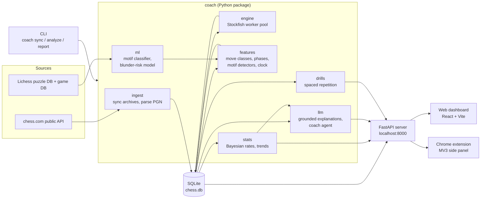

# Chess Coach: Plan & Architecture

A personal chess coach for chess.com user **atefmo-1**. It covers what chess.com puts behind its paywall (Game Review, Move Explanations, Advanced Stats) and adds something chess.com doesn't do: it analyzes **all** of your games together to find recurring weaknesses and turn them into training.

---

## 1. Starting point (checked 2026-10-24)

| Fact | Implication |
|---|---|
| 84 games, all **rapid** (71× 10+0, 7× 15+10, 6× 10+5), all in Oct 2026 | Small dataset. Stats need confidence intervals, and there's too little data to train a model on these games alone. |
| Rating 225 now, best 399. Record 38W / 40L / 6D. Puzzle rating 640 | At this level games are decided by hung pieces and missed 1–2 move tactics. Coaching should focus there, not on opening theory. |
| PGN includes **per-move clock times** (`[%clk 0:09:56.2]`) | Time-management analysis is possible: time spent per move, blunders under time pressure. |
| chess.com `accuracies` exist on only **15/84** games | We compute our own accuracy for every game. The 15 games become a **validation set** for our numbers. |
| Stockfish not installed; system Python is 3.9 | Setup step: Homebrew Stockfish and Python 3.12 via `uv`. |
| Public API, no auth: `api.chess.com/pub/player/{user}/games/archives` → monthly archives | Ingestion is easy and legal. Requests must be made one at a time (no parallel calls) with a descriptive User-Agent. |

---

## 2. Goals and non-goals

**Goals**
1. **Game Review**: every move rated (best / good / inaccuracy / mistake / blunder), plus a per-game accuracy score and the moment the game turned.
2. **Move Explanations**: plain-English explanations of *why* a move was bad or good, based on engine facts.
3. **Advanced Stats**: trends across all games (by phase, opening, color, clock, session/tilt, mistake type).
4. **Weakness model**: "your top 3 recurring problems", with evidence and how they change over time.
5. **Training**: personalized drills built from *your own* mistakes, with spaced repetition.
6. **Coach chat**: ask questions about your games in natural language.
7. **Real AI/ML work**: trained models with proper evaluation, not just LLM prompts.

**Non-goals / hard rules**
- **No help during live games, ever.** Using engine assistance while playing violates chess.com's Fair Play policy and gets accounts banned. Only **finished** games are analyzed, and the extension stays off on `/play` pages (see §9).
- No scraping beyond the public API. No storing other players' data beyond what's in your game records.
- Not a chess engine. We use Stockfish to evaluate positions and build everything else around it.

---

## 3. Architecture



**Design principles**
- **Engine for facts, LLM for words.** Every chess claim comes from Stockfish or `python-chess`. The LLM only turns verified facts into prose. LLMs analyzing positions on their own make things up.
- **Pipeline stages, each idempotent and cached.** sync → analyze → enrich → aggregate. Re-running is cheap, and engine results are cached by `(FEN, engine version, depth)`.
- **Local-first.** Everything runs on your Mac. The only outbound calls go to the chess.com API and the LLM API.
- **One backend, many frontends.** The CLI, dashboard, and extension all read from the same FastAPI server and database.

### Tech stack

| Layer | Choice | Why |
|---|---|---|
| Language | Python 3.12, managed with `uv` | The chess and ML tooling is in Python |
| Chess logic | `python-chess` | PGN parsing, legal moves, attack maps, UCI engine driver |
| Engine | Stockfish 17 (Homebrew) | Strongest free engine; MultiPV gives the best alternative moves |
| Storage | SQLite (+ DuckDB for ad-hoc analytics if needed) | Zero-ops, a single file, easy for the agent to query |
| ML | PyTorch (Apple MPS), scikit-learn / LightGBM for baselines | Train locally on an M-series Mac |
| API server | FastAPI + Pydantic | Typed, fast, auto-generated docs |
| Dashboard | React + Vite + `react-chessboard` + a chart lib | Interactive board replay; components reusable in the extension |
| Extension | Chrome Manifest V3, side panel | Shows analysis next to a finished game on chess.com |
| LLM | Claude API: Haiku 5.5 for bulk move explanations, Sonnet 5.5 for the coach agent | Cheap where volume is high, smart where reasoning matters |

---

## 4. Data model (SQLite)

```sql
players(username PK, rating_rapid, rating_best, last_synced_at)

games(
  id PK,                -- chess.com game id from URL
  url, uuid, end_time, time_class, time_control, rated,
  white, black, white_rating, black_rating,
  my_color,             -- 'white' | 'black'
  result,               -- 'win' | 'loss' | 'draw'
  termination,          -- checkmate, resignation, timeout, ...
  eco, opening_name,
  chesscom_accuracy,    -- nullable; validation only
  my_accuracy,          -- computed
  pgn,
  session_id            -- games <30 min apart = one session
)

moves(
  game_id FK, ply,      -- PK (game_id, ply)
  is_mine, san, uci,
  fen_before, fen_after,
  clock_after_s, time_spent_s,
  eval_before_cp, eval_after_cp,   -- from my perspective, mate mapped to ±10000
  win_pct_before, win_pct_after,
  best_uci, best_san, pv_best,     -- engine's line
  pv_after_played,                 -- refutation line
  move_class,                      -- best/excellent/good/inaccuracy/mistake/blunder/missed_win
  phase,                           -- opening/middlegame/endgame
  material_balance
)

move_tags(game_id, ply, tag, source, confidence)
  -- tag: hanging_piece, missed_fork, allowed_fork, missed_mate, back_rank, ...
  -- source: 'rules' | 'model'

engine_cache(fen, engine_version, depth, multipv_json, PK(fen, engine_version, depth))

explanations(game_id, ply, prompt_version, model, text, facts_json, created_at)

drills(
  id PK, game_id, ply, fen, solution_uci, motif,
  ease, interval_days, due_at, reps, lapses   -- SM-2 style scheduling
)

coach_notes(id PK, created_at, scope, body)    -- agent memory: weekly summaries
```

---

## 5. Analysis pipeline (core logic)

### 5.1 Ingest
- `GET /pub/player/atefmo-1/games/archives`, then fetch each monthly archive **one at a time**, sending `If-Modified-Since`/ETag so unchanged months are skipped.
- Parse PGN with `python-chess`: moves, `%clk` tags giving clock times, ECO and opening name, termination.
- Derive `my_color`, `result`, `time_spent_s` (clock difference plus increment), and `session_id`.

### 5.2 Engine analysis
- A pool of Stockfish processes (one per CPU core minus one). Each position is searched to a fixed **node budget** (e.g. 1M nodes), which gives reproducible results, with **MultiPV=3**.
- Rough cost: 84 games × ~70 plies ≈ 6k positions, so a few minutes on an M-series Mac. Cached by FEN, so repeated positions such as common openings are free.

### 5.3 Move classification (Lichess-style, public formulas)
- Win %: `50 + 50 * (2 / (1 + exp(-0.00368208 * cp)) - 1)`
- Move accuracy: `103.1668 * exp(-0.04354 * (win_before - win_after)) - 3.1669`, clamped to 0–100
- Game accuracy: a blend of the mean and harmonic mean of move accuracies, weighted by volatility (as Lichess does).
- Class thresholds follow chess.com's expected-points scale on the win% drop: < 2 excellent, < 5 good, < 10 inaccuracy, < 20 mistake, ≥ 20 blunder. "Best" is the engine's top move; "great" is the only good move (next best ≥ 20 points worse) in a position that mattered.
- **Validation:** correlate our accuracy with chess.com's on the 15 games that have it. Target Pearson r ≥ 0.8. (chess.com's exact formula is private, so we only need the same ranking, not identical values.)

### 5.4 Enrichment: what kind of mistake?
Rule-based detectors written with `python-chess` (version 1), with each rule covered by unit tests built from hand-made positions:

| Tag | Rule |
|---|---|
| `hanging_piece` | After my move, the opponent can win a piece for nothing: it is attacked and not defended, or attacked by a less valuable piece |
| `allowed_fork` / `missed_fork` | The best reply, or my best move, attacks ≥2 valuable targets |
| `allowed_mate` / `missed_mate` | Mate-in-N in the engine line |
| `pin`, `skewer`, `discovered_attack` | Line-geometry checks on the engine's best line |
| `back_rank` | Mate threat on the back rank with the king boxed in by its own pawns |
| `time_trouble` | Clock < 60s, or time spent < 3s on a critical move |
| `opening_principle` | Early queen moves, undeveloped pieces, king not castled by move 12 |

Version 2 replaces or augments these rules with the trained **motif classifier** (§7.1). Each tag records its `source` so the two can be compared.

### 5.5 Stats & weakness model
With only 84 games, raw percentages are noisy. Rates use a **Beta-Binomial** model with credible intervals, so the dashboard says "hangs a piece in 37% (28–46%) of games" instead of reporting a single exact figure.

Breakdowns:
- **Phase**: accuracy and blunders per 10 moves for opening / middlegame / endgame
- **Opening**: score and accuracy per ECO family, split by color
- **Clock**: blunder rate vs. remaining time, time spent before blunders, and how often games are lost on time
- **Tilt**: performance in game N+1 after a loss compared with after a win; performance late in long sessions
- **Conversion**: how often you win games where you were ever +3 or better (ability to convert winning positions)
- **Trends**: rolling 20-game window for every metric, for "are you improving?"

**Weakness ranking** = (frequency × average win% lost) for each tag, keeping only tags whose lower confidence bound is meaningfully above the baseline. The top 3 drive the drills and the coach's advice.

---

## 6. LLM layer

### 6.1 Grounded move explanations
For a flagged move, build a **fact sheet** from the engine and `python-chess`:

```json
{
  "played": "Nf6", "best": "Bxf7+", "win_pct_lost": 34,
  "refutation_line": ["Qh5", "g6", "Qxe5+"],
  "best_line": ["Bxf7+", "Kxf7", "Ng5+"],
  "pieces_left_hanging": ["e5 pawn", "h8 rook"],
  "tags": ["missed_fork", "allowed_fork"],
  "phase": "opening", "clock_s": 412
}
```

The LLM (Haiku 5.5) writes 2–3 sentences using **only** this fact sheet, at a ~300–600-rated reading level. Output is cached in `explanations`.

**Hallucination guard:** after generation, extract every square and SAN move mentioned in the text and reject or regenerate if any are absent from the fact sheet. This check also serves as an automated eval metric.

### 6.2 Coach agent
A chat agent (Sonnet 5.5) using tool calling. The tools are typed (not raw SQL by default):

| Tool | Returns |
|---|---|
| `get_summary(period)` | Headline stats and top weaknesses |
| `query_stats(metric, group_by, filters)` | Aggregates from §5.5 |
| `find_positions(tag, phase?, color?, limit)` | Example positions with game links |
| `get_game(game_id)` | Moves, classes, key moments |
| `explain_move(game_id, ply)` | Grounded explanation (§6.1) |
| `create_drill_set(tag, n)` | Drills from your own mistakes |
| `run_readonly_sql(query)` | Escape hatch over a read-only connection |

**Memory:** after each sync, the agent writes a short `coach_notes` entry ("this week: fewer hung pieces, still losing on time in 10+0"), so later conversations can refer to your progress.

### 6.3 LLM evals
- A **golden set** of ~50 of your own positions with hand-checked explanations. Each one is scored for factual grounding (automated check) plus clarity and correctness (LLM-as-judge, spot-checked by you).
- Every prompt change gets a new `prompt_version` and is re-run against the golden set before it ships.

---

## 7. ML components (the AI/ML core)

Your 84 games are the **test** data. Training data comes from Lichess's open datasets (CC0).

### 7.1 Tactical motif classifier ★ main ML project
- **Data:** the Lichess puzzle database (millions of puzzles, each with a FEN, the solution moves, a rating, and **theme labels** such as `fork`, `pin`, `hangingPiece`, `mateIn1`, `backRankMate`, `discoveredAttack`). The labels are free.
  - Note: a puzzle's FEN is the position *before* the opponent's move. Apply the first move to get the puzzle position.
- **Task:** multi-label classification. Input is the position plus the key move. Output is the set of motifs (~15 themes relevant at your level).
- **Models:**
  1. Baseline: the rule-based detectors from §5.4, with no training
  2. LightGBM on handcrafted features (attack counts, piece values attacked, checks, king safety)
  3. A small ResNet CNN in PyTorch on 8×8×N board planes plus a move encoding, trained on MPS
- **Eval:** per-theme F1 on held-out puzzles, **plus** ~100 of your own blunders labeled by hand, the set that actually matters. Report where the CNN beats the rules and where it doesn't.
- **Use:** tags each of your mistakes in two ways: "the tactic you missed" (your position plus the best move) and "the tactic you allowed" (the position after your move plus the opponent's best reply).

### 7.2 Blunder-risk model (stretch)
- **Data:** a monthly Lichess game dump filtered to rapid games between low-rated players, keeping games with `%eval` annotations.
- **Task:** P(this player blunders on this move | position features, clock, rating).
- **Use:** a "danger meter" in reviews ("this was a position where most players at your level go wrong") and picking drills by difficulty.
- Note: Lichess ratings sit higher than chess.com's at the low end, so the rating filter needs calibrating.

### 7.3 Human-move model (stretch)
- Integrate the open-source **Maia-2** model (it predicts the move a human of a given rating would play) for "what would a typical player at your level play here?" Check its supported rating range before relying on it at 225.

---

## 8. Drills (training loop)

- Source: your own `mistake`/`blunder` moves where the best move is clear (a big gap between MultiPV 1 and 2), ranked by the weakness ranking.
- Format: "find the best move" from your real position, in a board UI. On a wrong answer, show the grounded explanation.
- Scheduling: SM-2 spaced repetition (the `drills` table). Positions you miss come back sooner.
- Also mix in Lichess puzzles with the same motif for variety.
- **Closes the loop:** drill accuracy per motif is shown next to in-game blunder rate per motif, to answer "is training actually transferring?"

---

## 9. Frontends

### 9.1 CLI (Phase 1 to 2)
```
coach sync               # pull new games
coach analyze            # engine + classification + tags
coach report             # HTML/Markdown report: top weaknesses, examples
coach review <game_id>   # terminal review of one game
```

### 9.2 Web dashboard (Phase 3+)
- **Overview:** rating trend, accuracy trend, top 3 weaknesses with intervals
- **Game list → Game review:** board replay, eval graph, move classes, explanations
- **Stats:** phase / opening / clock / tilt breakdowns
- **Drills:** spaced-repetition trainer
- **Coach:** chat panel

### 9.3 Chrome extension (last)
- Manifest V3 side panel, active only on `chess.com/game/live/<id>` and `/game/daily/<id>` pages.
- **Fair-play guard:** before showing anything, confirm that `<id>` exists in your **finished** games archive via the backend. Disabled on `/play/*`. No content script reads the live board.
- Shows the same review components as the dashboard, fetched from `localhost:8000`.

---

## 10. Repo layout

```
chess-coach/
├── PLAN.md
├── pyproject.toml            # uv-managed
├── coach/
│   ├── cli.py
│   ├── config.py
│   ├── db/        schema.sql, repo.py
│   ├── ingest/    chesscom.py, pgn.py
│   ├── engine/    pool.py, analyze.py
│   ├── features/  classify.py, phases.py, motifs.py, clock.py
│   ├── stats/     rates.py, breakdowns.py, weaknesses.py
│   ├── ml/
│   │   ├── data/       lichess_puzzles.py, lichess_games.py
│   │   ├── motif/      features.py, model.py, train.py, eval.py
│   │   └── blunder/    ...
│   ├── llm/       facts.py, explain.py, agent.py, tools.py, prompts/
│   ├── drills/    scheduler.py, select.py
│   └── api/       main.py, routes/
├── web/                      # React + Vite
├── extension/                # MV3
├── evals/                    # golden sets, eval scripts
├── notebooks/                # exploration
├── tests/                    # pytest; FEN fixtures for motif rules
└── data/                     # gitignored: chess.db, Lichess dumps, model weights
```

---

## 11. Roadmap

Each phase ends with something usable.

**Status (2026-10-24):** phases 0–3 are built. Sync, engine analysis, grading, rule-based tactic tags, stats with intervals, static export, and the dashboard (game review, patterns, all games) all work. The dashboard reads exported JSON, so it deploys as a static site. Engine-backed explanations are templated from engine facts; LLM wording (phase 4) is next.

| # | Phase | Deliverable | Done when |
|---|---|---|---|
| 0 | **Setup** | git, `uv`, Python 3.12, Stockfish, skeleton package, pytest | `coach --help` runs, `stockfish` responds |
| 1 | **Ingest + engine** | `coach sync`, `coach analyze` | All 84 games in DB, every move has an eval and class; accuracy correlates with chess.com's on the 15 validation games |
| 2 | **Rule-based motifs + report** | `coach report` | Report lists top weaknesses with counts, intervals, and example positions; motif rules pass unit tests |
| 3 | **API + dashboard** | FastAPI + React overview, game review, stats | You can click through any game with an eval graph and move classes |
| 4 | **Grounded explanations** | Explanations in game review | Hallucination check passes on ≥95% of golden-set positions |
| 5 | **ML: motif classifier** | Trained model + eval report | Beats the rule baseline on your hand-labeled blunders (or the report says clearly why not) |
| 6 | **Coach agent** | Chat panel | Correctly answers 20 scripted questions about your games |
| 7 | **Drills** | Spaced-repetition trainer | Daily drill set drawn from your mistakes |
| 8 | **Chrome extension** | Side panel on finished games | Shows the review on finished games only; does nothing on `/play` |
| 9 | **Stretch** | Blunder-risk model, Maia-2, scheduled auto-sync | — |

**Suggested order if time is short:** 0 → 1 → 2 gives a useful product. 5 is the ML centerpiece. 3, 4, and 6 make it look like a real app.

---

## 12. Risks

| Risk | Mitigation |
|---|---|
| Small personal dataset → noisy conclusions | Bayesian intervals; show `n`; data grows as you play |
| Accuracy numbers differ from chess.com's | Validate ranking, not exact values; document the formula |
| LLM invents chess facts | Fact-sheet-only prompting + automated square/move check + golden set |
| Puzzle positions ≠ real blunder positions (domain shift) | Evaluate on your own hand-labeled blunders, not only on puzzles |
| Lichess dumps are huge | Stream-parse and filter; sample; keep only what's needed |
| chess.com API rate limits / changes | Requests one at a time, caching, ETags, retry with backoff |
| Fair-play violation | Finished games only; extension guard; no live-board access |

---

## 13. Open decisions (defaults chosen; change any)

1. **Dashboard stack:** React (default; reusable in the extension) vs. Streamlit (faster to build, less polished).
2. **LLM provider:** Claude API (default). Needs an API key; costs are small at this volume because explanations are cached.
3. **Hosting:** local-only (default) vs. deploying it so friends can use it with their own usernames, which would also make it a stronger portfolio piece.
4. **Multi-user:** schema already keys on username, so supporting other users later is cheap.
