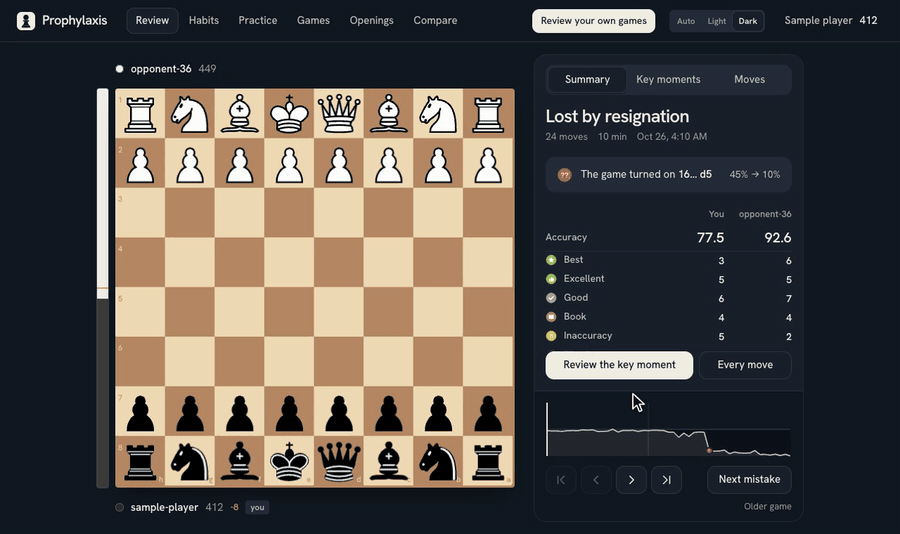

# Prophylaxis

In chess, *prophylaxis* means seeing a problem coming and stopping it before it happens. This does that for your own habits.

[](https://github.com/atefmo-1/prophylaxis/actions/workflows/pages.yml)

**Try it: [atefmo-1.github.io/prophylaxis](https://atefmo-1.github.io/prophylaxis/)**. Enter your chess.com or Lichess username; nothing to install, no account. Or open [the sample player](https://atefmo-1.github.io/prophylaxis/?demo) straight away.



A free chess coach for anyone who plays on chess.com or Lichess. It covers what chess.com puts behind its paywall (game review, move grades, advanced stats), and it also looks across all your games to rank the habits that cost you the most.

- **Game review:** opens on a chess.com-style report card, then walks you through your key moments as puzzles ("find a better move"), accepting any move that holds your position. Every move is graded on chess.com's scale (brilliant, great, best … book … miss, blunder) with a scoresheet, eval bar, winning-chances graph and a plain-English explanation.
- **Habits:** your #1 habit with a position from your own games, six skill areas, and every habit ranked by how much winning chance it costs you in an average game, each with practice from your own positions or puzzles of its tactic.
- **Practice:** five positions at a time from your own mistakes, spaced out so the ones you miss come back sooner, plus Lichess puzzles of the tactic behind each tactic habit, at your level.
- **Openings:** your first ten moves across all your games, merged into one tree, with how each line turned out.
- **Compare:** you against any player on your site. Their last 30 rated games in your time control are reviewed in your browser like yours, then shown side by side with yours, with tips for beating them drawn from their numbers (their costliest habits, where and when they go wrong, how they convert, their openings), each with its evidence.
- **How hard was it, at your rating?** On each mistake, how many players at your rating find the better move, whether your move is a common mistake at your level, and how many players at your opponent's rating would have found the punishing answer. From Maia-3, a model of how people play at each rating, checked against real chess.com games.
- **Honest numbers:** with a few dozen games, rates are shown with a 90% interval, not as falsely exact percentages, and Compare gives either side the edge only when the gap is clear.
- **Private:** everything runs in your browser. Your games, your username and your analysis stay there; there is no server.

Only finished games are analysed. It never helps during a live game (chess.com Fair Play policy).

## What's been measured

Every number the site shows rests on a test, and so do the things it doesn't show. Each study keeps its data out of the repo and publishes counts only.

| Question | Answer | Details |
|---|---|---|
| Does its accuracy agree with chess.com's? | Mostly. Rank correlation 0.75 (95% interval 0.69 to 0.80) and Pearson 0.71 on 436 player-games from 218 random chess.com games; 7.6 points apart on average, with no real bias. An earlier r = 0.85 came from only 17 games. | [ml/results/accuracy.md](ml/results/accuracy.md) |
| Does the tactic model name tactics the rules can't? | Yes. On 10,324 real blunders from Lichess players rated 1300 or less, labelled by Lichess's own tagger: discovered attacks F1 0.89, skewers 0.83, trapped pieces 0.78, where the rules score 0; forks 0.91 against the rules' 0.81. | [ml/REPORT.md](ml/REPORT.md) |
| Is "about 3 in 10 players at your rating find this" true? | Yes, within 0.9 percentage points, on 11,230 moves from held-out chess.com games where the players average under 1000. | [ml/results/maia.md](ml/results/maia.md) |
| Does the browser give the same answers as the reference? | Yes, checked in CI on every push: grading against the Python pipeline, Maia's board encoding (84 of 84 positions identical) and chances against PyTorch, and the practice scheduler against the reference FSRS (0 of 320 intervals differ). | [web/scripts/](web/scripts/) |
| Why do some mistakes get no reason? | A census of beginner mistakes found the causes; threat, pawn and longer-line checks took the share given a reason from about 35% to about 55%. | [reports/](reports/) |
| Can one game place a player's rating? | No: on 529 games the best model missed by about 300 points, so the site doesn't estimate one. | [ml/rating/REPORT.md](ml/rating/REPORT.md) |
| Is it fast on a phone? | Lighthouse (mobile, live site): performance 98 on the landing page and 92 with the sample player, and 100 for accessibility, best practices and SEO. A first visit downloads about 0.2 MB; the engines and models load only when a review needs them. | [Lighthouse](https://developer.chrome.com/docs/lighthouse) |
| Does the site meet basic accessibility rules? | axe-core finds no WCAG 2.1 A or AA problem on any page, light or dark, desktop or phone; board coordinates are measured separately (4.6:1 or better). | [web/scripts/check-a11y.mjs](web/scripts/check-a11y.mjs) |

**Still to test:** whether players accept the explanations (a "Was this explanation right?" question is built, and asks once anonymous counting is switched on), and a second person's labels for the tactic check, which so far rests on the owner's answers to 46 blunders.

## How to use it

### The site

1. Open [the site](https://atefmo-1.github.io/prophylaxis/) on any device, choose chess.com or Lichess, and enter your username.
2. Your games load from the site's public API and Stockfish starts reading them, in your browser, on as many cores as your device can spare. Your latest game is reviewed first, in seconds on a laptop; your other recent games follow in the background, newest first, while you read. The first visit reviews as many games as your device gets through in about five minutes (at least 5, so Habits has something to show), and **Games** offers to review more. The top bar shows the progress and a pause button, with the time left on a wide screen (on a phone, both are in the player menu, which always shows the time left), and reviewing pauses by itself when the battery is low and not charging. Close the tab and it picks up where it left off next time, then checks for new games whenever you come back.
3. Use the six pages:
   - **Review** opens on your latest game. The **Summary** tab is the report card. **Review the key moment** (or **Review N key moments**) turns your worst moves into puzzles: drag a piece to find a better move, or press Tab to reach the board and type it; **Hint**, **Show the answer** and **Skip** are there when you're stuck. The **Moves** tab steps through the game with an explanation for every move (arrow keys, the buttons under the graph, or **Next mistake**).
   - **Habits** shows your #1 habit with a real position, then skill areas and every habit ranked by what it costs. It fills in once 5 games are reviewed.
   - **Practice** gives you five positions at a time from your own mistakes, with **Skip** for ones you'd rather leave. They are scheduled with FSRS, the spaced-repetition model behind Anki: a position comes back when you're expected to have about a 90% chance of still finding the move. Ones you miss come back the next day; ones you find first time come back later than ones that took a few tries or a hint, and the gap grows each time you find it. Each tactic habit also has **Puzzles**: Lichess puzzles of that tactic that start near your level, get harder as you solve them and easier when you miss.
   - **Games** lists every reviewed game; filter by result and colour. Older games not reviewed yet can be added from here with **Review N more games**.
   - **Openings** merges your first ten moves into one tree: click a move to follow it, **Back** to step back.
   - **Compare** takes any username on your site (or one of the players you've met most), reviews their last 30 rated games in your main time control (about 2–3 minutes on a laptop, after your own games are done; the comparison appears after 10, and it keeps going while you look at other pages), and shows the two of you side by side, how to beat them, and their opening tree. Their reviews stay in your browser, so comparing again is instant, and deleting your data deletes them too, unless another player in this browser compared with them.

Your name in the top bar opens a menu to switch to another player, open your chess.com or Lichess profile, or delete your reviews from this browser.

### The Chrome extension (optional)

It reviews each game the moment it ends, beside the board on chess.com.

1. **Install it.** Download `prophylaxis-extension-0.1.0.zip` from the [latest release](https://github.com/atefmo-1/prophylaxis/releases/latest) and unzip it. Open `chrome://extensions`, turn on **Developer mode**, click **Load unpacked** and pick the unzipped folder. Pin it to the toolbar. (Or build it yourself: `npm --prefix web install && npm --prefix web run build:extension`, then load `web/dist-extension`.)
2. **Set it up.** Click the toolbar icon to open the side panel. The first time, it asks for your chess.com username (and suggests the one you use on the site, if you've opened it).
3. **Play.** When a game ends, the side panel opens and replays the game while Stockfish reads it (about 20 to 30 seconds), then shows the review. If Chrome doesn't open it by itself, click anywhere on the chess.com page. Keep the panel open and it follows every game you finish.
4. **The site and the extension share.** Games the extension reviewed appear on the site straight away, without being analysed again, and the site tells the extension your habits, so a review in the panel says which habit a mistake belongs to. If you open the site with the extension installed, it offers to continue as the extension's player.

## How it works

The eight main design decisions, each explained as if at a whiteboard, are in [docs/whiteboard.md](docs/whiteboard.md).

```
chess.com or Lichess API ──► your browser: Stockfish 19 Lite (WebAssembly, one Web Worker per spare core)
                                          └─► grading: win %, accuracy, move classes
                                          └─► tactic rules: hung pieces, forks, missed mates, clock
                                          └─► tactic classifier (ONNX, onnxruntime-web, its own Web Worker): names pins, skewers, …
                                          └─► Maia-3 (ONNX, its own Web Worker): how many players at your rating find the better move
                                          └─► stats: Jeffreys intervals, habit ranking
                                          └─► saved in IndexedDB ──► Review · Habits · Practice · Games · Openings · Compare
```

| Part | Where |
|---|---|
| Reading games from chess.com (CORS is open; one request at a time; a past month is fetched once more after it ends, then kept) | `web/src/library/chesscom.ts` |
| Reading games from Lichess (CORS is open; the games export, as NDJSON, turned into chess.com's shape; later visits ask only for newer games). A Lichess player is kept as `lichess:name`, so the two sites never share stored games | `web/src/library/lichess.ts`, `web/src/lib/player.ts` |
| Background review queue, newest first, within a time budget; pausing; the browser store | `web/src/library/Library.tsx`, `web/src/library/store.ts` |
| How many engines this device runs, a one-second speed check, time estimates; the engines sharing a game | `web/src/library/device.ts`, `web/src/analysis/pool.ts` |
| One game: engine lines, grades, tactic tags, puzzles for each mistake | `web/src/analysis/review.ts`, `motifs.ts`, `grading.ts` |
| The trained tactic classifier, and how its tags combine with the rules' | `web/src/analysis/tactics.ts`, `tactics.worker.ts`, `planes.ts` |
| Maia-3 on your mistakes: the rating map, the board encoding, findable and common-mistake sentences (study: `ml/results/maia.md`) | `web/src/analysis/maia.ts`, `maia.worker.ts`, `web/src/lib/explain.ts` |
| Statistics across games: intervals, habits, skills, practice positions | `web/src/analysis/stats.ts` |
| The opening tree | `web/src/lib/openingTree.ts`, `web/src/components/OpeningTree.tsx` |
| Comparing with another player, and the tips for beating them | `web/src/library/compare.ts`, `web/src/library/Comparison.tsx`, `web/src/lib/tips.ts` |
| Pages (React + Vite + TypeScript, chessground board; Radix Tabs and ToggleGroup for keyboard behaviour, styled by the site) | `web/src/` |

### The Python pipeline: the reference

`src/coach/` is the original pipeline, kept as the reference and the lab: full Stockfish 19 at 1 million nodes, SQLite, and the same grading, tactic rules and statistics. The browser's grading is checked against it on shared positions (`web/scripts/check-grading.ts`), and its statistics are a port of `stats.py`. Its accuracy formula, which the site shares, agrees with chess.com's: rank correlation 0.75 on 436 player-games ([ml/results/accuracy.md](ml/results/accuracy.md)).

```bash
uv run coach sync --username <chess.com username>   # download games into data/chess.db
uv run coach analyze                                 # Stockfish + grading
uv run coach summary                                 # top weaknesses in the terminal
uv run coach export                                  # JSON into data/export/
```

Needs [uv](https://docs.astral.sh/uv/) and Stockfish on your `PATH` (or `STOCKFISH_PATH`). Everything it writes stays in `data/`, which git ignores.

### The tactic classifier: `ml/`

A small ResNet (a convolutional network) that names the tactic behind a mistake (fork, pin, skewer, discovered attack, trapped piece, back-rank mate and more) from the position and Stockfish's line. It is built from 4.8 million Lichess puzzles (CC0; 80% for training, the rest held out) and checked on 10,000 real games between Lichess players rated 1300 or less. On held-out puzzles its macro F1 over 15 themes is 0.91, against 0.80 for a gradient-boosted baseline on 84 handcrafted features (the hand-written rules score 0.27, but they only try 5 of the 15 themes). On real beginner blunders it names discovered attacks (F1 0.89), skewers (0.83) and trapped pieces (0.78), which the rules couldn't name at all. It scored 0.81 on pins too, but a check by a person accepted only about a third of its pins, so the site doesn't name them. The rules still win on mates and still decide whether material was really lost; the model names what they leave generic, and only for themes where it beat them on both puzzles and real games. The name then drives the habit, the arrows on the board and the practice puzzles. It ships quantised to 0.98 MB. Data, split, metrics and limits: [ml/REPORT.md](ml/REPORT.md).

```bash
cd ml && uv run tactics all   # download, build the splits, train LightGBM and the CNN, export, score
```

## Running the site locally

```bash
npm --prefix web install
npm --prefix web run dev   # http://localhost:5173
```

Every push to `main` deploys the site to GitHub Pages (`.github/workflows/pages.yml`), once ruff, the Python tests and the site's grading check pass. It's a static site with no data in it, so it also runs from any other host or sub-folder (`npm --prefix web run build` → `web/dist/`).

## How the extension works

- **Opening by itself:** the panel opens when chess.com shows its game-over card. Chrome only lets an extension open the panel within about 5 seconds of a click on the page. That usually holds when your own move ends the game. When it doesn't (your opponent resigned, a premove, a slow card), your next click anywhere on the page opens it, and the toolbar popup offers a one-click "Open review". Turn auto-open off in Settings.
- **Waiting for chess.com:** chess.com takes a few seconds, sometimes a couple of minutes, to list a finished game in its public archive. The background worker waits for it, so you can leave the game page, and the panel shows how long it has been waiting.
- **Fair play:** the extension never reads the live board, and it reviews a game only once chess.com's public archive lists it, which happens after the game is over.
- **Sharing with the site:** a small script on the site's pages (`web/extension/public/site-bridge.js`) passes messages between the page and the extension, all inside the browser. The site asks for the reviews the extension made (in the site's own format, with the facts its statistics need) and sends back the player's habits. Without the extension, the site's questions simply go unanswered after a moment.

Stockfish is GPLv3; its licence ships with the site and the extension in `engine/COPYING.txt`.

## Tests

```bash
uv run pytest                                      # grading (incl. Brilliant and Book), openings, intervals, tactic rules
(cd ml && uv run pytest)                           # tactic classifier: data, features, encoder parity with TypeScript
npm --prefix web run typecheck
node web/scripts/check-grading.ts                            # Brilliant and Book in TypeScript give Python's answers
node web/scripts/check-maia.ts tests/fixtures/maia.json      # Maia's encoding matches the authors' code; the shipped model matches PyTorch
node web/scripts/check-review.mjs                            # the review in Chrome with the sample player: summary, key moment, wrong and right tries (dev server running)
node web/scripts/check-pages.mjs                             # every page at desktop and phone size, plus a practice solve (dev server running)
node web/scripts/check-a11y.mjs                              # axe-core WCAG 2.1 AA on every page, light and dark, desktop and phone, plus board coordinates (dev server running)
node web/scripts/check-start.mjs <username>                  # the site end to end in Chrome, for any player
node web/scripts/check-device.mjs <username> [laptop|phone]   # engines, time budget, time left, pausing, as a laptop or a slow phone
node web/scripts/check-extension.mjs <username> <gameId>     # the extension's post-game review
node web/scripts/check-bridge.mjs <username>                 # extension and site together (dev server running)
```

## Roadmap

See [PLAN.md](PLAN.md): a blunder-risk model, grounded LLM move explanations and a coach chat.

## Licence

GPL-3.0-or-later (see [LICENSE](LICENSE)). Stockfish, which the site and extension run, is also GPLv3. The opening book is [Lichess's openings list](https://github.com/lichess-org/chess-openings) (CC0), in `web/public/openings/`.

The site also runs **Maia-3 5M** (CSSLab, University of Toronto; [github.com/CSSLab/maia3](https://github.com/CSSLab/maia3)), which is AGPL-3.0 (see [LICENSES/AGPL-3.0.txt](LICENSES/AGPL-3.0.txt)). It predicts the moves players make at a given rating; the review uses it to say how many players at your rating find the better move. The model file, `web/public/models/maia3.onnx`, is exported from the authors' official checkpoint ([huggingface.co/UofTCSSLab/Maia3-5M](https://huggingface.co/UofTCSSLab/Maia3-5M)) by `ml/maia/export.py`, which rebuilds it. The files that encode positions for it (`web/src/analysis/maia.ts`, `maia.worker.ts`, `web/scripts/check-maia.ts` and `ml/maia/`) are AGPL-3.0 too. Prophylaxis's own code stays GPL-3.0-or-later. The site as a whole, and any fork of it that keeps Maia, also comes under AGPL-3.0 section 13: if you run a modified copy for others to use, offer them its source. GPLv3 section 13 allows this combination. The Chrome extension doesn't include Maia. Maia-3 is described in Monroe, Eilender, Chalmers, Tang and Anderson, [*Chessformer: A Unified Architecture for Chess Modeling*](https://openreview.net/forum?id=2ltBRzEHyd), ICLR 2026.
